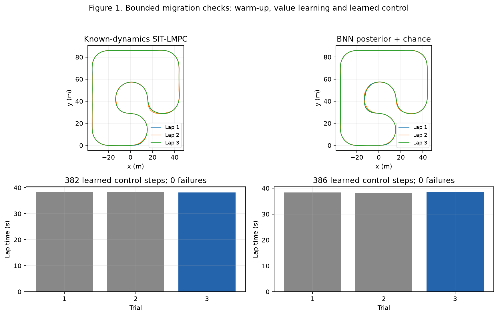

# SIT-LMPC Remastered: migration validation

## Main findings

- The racecar implementation is installed in this repository's own Python 3.13 uv environment. Main-package and dependency imports resolve inside this checkout; no runtime imports resolve to BRO-LMPC or sibling package sources.
- Both explicit real-GPU configurations completed three successful laps, including one learned-control lap. The known-dynamics baseline and Gaussian BNN/chance path both fitted two value generations.
- The BNN run collected 663 unique fitting transitions and published one Gaussian belief generation. Subsequent candidates that did not satisfy calibration were held rather than replacing the published belief.
- A copied self-contained BNN checkpoint resumed with `checkpoint: null` and applied 28 additional controls, retaining the value generation and latent belief.
- **637 selected checks pass across full-suite runs and focused reruns:** 479 unit/configuration checks and 158 integration checks. The test migration made feature flags explicit, supplied shared fixtures and corrected stale colorbar/event-order assumptions. Numerical controller kernels were retained.

**Table 1. Bounded real-GPU checks.**

| Check | Successful / failed laps | Applied controls | Learned-control steps | Value generations | Published belief generation |
|---|---:|---:|---:|---:|---:|
| Known-dynamics SIT-LMPC | 3 / 0 | 1,150 | 382 | 2 | 0 |
| BNN posterior + chance constraints | 3 / 0 | 1,152 | 386 | 2 | 1 |
| Copied BNN checkpoint resume | 3 prior / 0 | 1,180 total | 28 additional | 2 retained | 1 retained |



**Figure 1.** The first two laps use MPPI warm-up; the third uses learned LMPPI. These are functional checks with reduced sampling and two training epochs, not a comparison of final learning performance. The BNN run exercised both feasible chance selection and the explicit conservative fallback when its sampled terminal-hull condition was infeasible.

## Verification scope

**Table 2. Software checks.**

| Area | Evidence |
|---|---|
| Core geometry/control | Safe-set hulls, normalized costs, lambda preference, finish-line extension, invalid-sample exclusion, state/state-action endpoint queries |
| BNN dynamics | Coherent function sampling, posterior evidence, calibrated power selection, checkpoint restoration and attempted-update publication |
| Probability constraints | Active-only lambda dimensions, boundary/hull probabilities, independent verification and reused empirical scenarios, fallback/stop paths |
| Experiment lifecycle | Success/failure/incomplete trajectories, reset behavior, checkpoint portability, changed resume settings and deterministic seeds |
| Diagnostics | Qt offscreen keyboard plots, pause/step/close behavior and matplotlib summary paths |
| New migration surface | Known-dynamics defaults, nested relative YAML inheritance, cycle/unknown-key rejection, CLI artifact import and dependency isolation |
| Packaging | Source/wheel builds, dependency consistency, vendored sources included in source archive, Git exclusion of runtime artifacts |

All 259 originally copied source files still match their recorded source hashes at verification time. Changes to this new implementation are recorded separately in the destination hashes in the provenance manifest. Existing repositories, their environments and their results were not modified.

## Reproduce

```bash
uv sync --extra gpu --extra plots --extra dev
uv run pytest tests/unit -q
uv run pytest tests/integration -q
uv run ruff check src tests scripts
uv pip check
uv build
```

The real-GPU checks use `tests/configs/st-smoke.yaml`, `tests/configs/bnn-chance-smoke.yaml` and `tests/configs/bnn-resume-smoke.yaml`. Their output directories must be absent or changed before rerunning: the experiment runner refuses to overwrite nonempty output directories. Resume uses a copied `trial-000003` checkpoint at `results/portable-bnn-checkpoint`.

## Limits and configuration details

The real runs used custom1, friction 0.5, nominal mass, seed 119, no input/actuator noise, 128 action samples, a 10-step horizon, two NF training epochs and one retained safe-set lap. The BNN smoke used 8 function samples, not the supplied normal preset's 64. Unit/integration checks run on CPU; the two physical simulator/controller runs used the local RTX 4090 through JAX GPU.

The imported model is the existing v2 latent-96 population, fingerprint `b3a4253989e698425b6eb8db8097878cdb06106aa57319ab8ef7eed5fbcaba7b`. Its learned transition interval is 0.1 s and its training integration substep is 0.01 s; the retained Gym plant substep is 0.02 s, matching the previous v2 experiment. The runner records this numerical mismatch rather than treating the predictor as ground truth.

The BNN chance preset preserves the previous experiment's permissive terminal-hull violation threshold of 0.9 and conservative fallback. It does not guarantee that every applied candidate satisfies the chance thresholds. No new long-run, varied-physics benchmark or offline population-training campaign was launched.

- [Resolved real-GPU results](REAL_GPU_VALIDATION.json).
- Dependency import paths were checked in the project-local environment; machine-specific path listings are excluded from the shared repository.
- [BNN source/fingerprint](BNN_MODEL_IMPORT.json).
- [Source and destination hashes](MIGRATION_SOURCE_MANIFEST.json).
- [Architecture and mathematical definitions](ARCHITECTURE_AND_DYNAMICS.md).

Validated: 2026-11-07T13:32:31.351805-05:00 (US Eastern).

- [Offline source-archive validation](SOURCE_ARCHIVE_VALIDATION.json).
- [Machine-readable validation summary](MIGRATION_VALIDATION_RESULTS.json).
