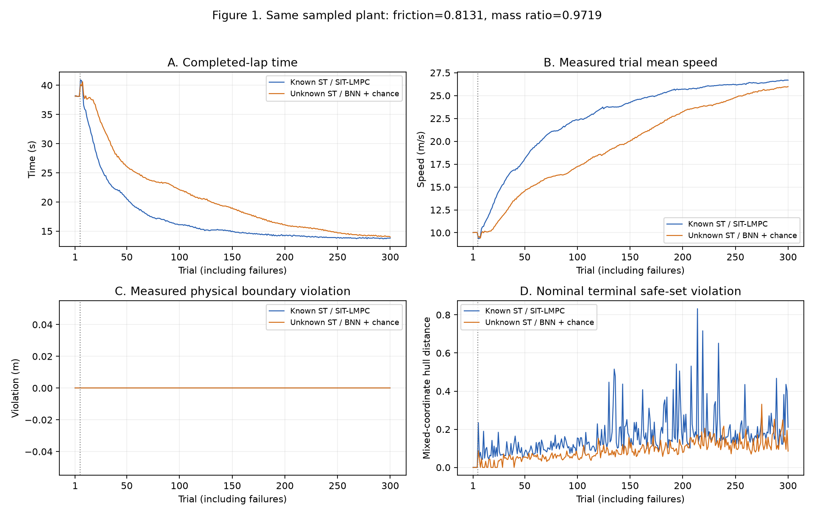
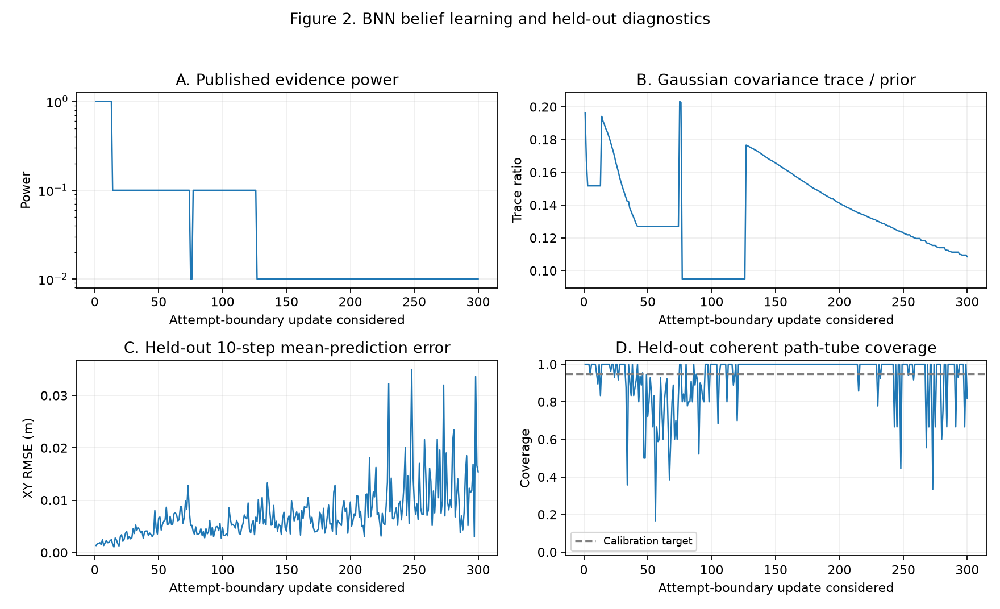

# Racecar: known dynamics and learned BNN distribution

## Main findings

- Both controllers completed **300 successful laps with zero failed attempts or measured physical boundary violations** on the same sampled ST plant: friction **0.813071**, mass ratio **0.971861**.
- Known-dynamics SIT-LMPC reached a best learned lap of **13.7 s**; the BNN with online belief updates and chance constraints reached **14.0 s**, approximately 2.2% slower at the best observed lap.
- The BNN retained **34,793 fitting transitions**, published **176 Gaussian belief updates**, and finished with evidence power **0.01**. Neural features remained fixed; the online learner updated the Gaussian latent belief.
- Conservative chance fallback was used on **5,678 of 60,389 learned-control steps (9.4%)**. These applied controls did not all satisfy the chance thresholds.
- Final held-out 10-step mean XY error was **15.4 mm**; function-path tube coverage was **81.8% over 11 evaluated windows**, below the 95% calibration target. Zero physical failures in this one-plant experiment do not establish calibrated safety probabilities or robustness to other plants.

**Table 1. Recorded outcomes.**

| Controller | Successful / failed | Applied controls | Value generations | Belief generations | Best learned lap | Final lap |
|---|---:|---:|---:|---:|---:|---:|
| Known ST / SIT-LMPC | 300 / 0 | 51,836 | 299 | 0 | 13.7 s | 13.8 s |
| Unknown ST / BNN + chance | 300 / 0 | 62,295 | 299 | 176 | 14.0 s | 14.0 s |



**Figure 1.** The first five trials use MPPI warm-up, followed by learned LMPPI. Physical boundary violation is measured from the actual simulator state against the 4 m center-position limit. Nominal terminal safe-set violation is a planner quantity, not a physical track exit. The 0.03 m inward planning margin is separate from the physical failure boundary.



**Figure 2.** Each point corresponds to an attempted belief update after a lap. Held candidates retain the published belief while accumulating evidence. Coverage is evaluated on held-out function-only XY rollout tubes, independently of the calibration split. The number of complete evaluation windows varies between updates.

## Run the examples

From the repository root:

```bash
uv sync --extra gpu --extra plots --extra dev

# Reproduce the two-phase procedure: ten attempts, then resume to 300 total.
uv run python examples/racecar/run_example.py --controller known-dynamics
uv run python examples/racecar/run_example.py --controller bnn-unknown

# Run both sequentially, or use --max-laps 12 for a shorter check.
uv run python examples/racecar/run_example.py --controller both --max-laps 12
```

The script creates a fresh timestamped output root under `results/custom1/`. `--max-laps` counts successful and failed attempts; SIT-LMPC stops at its first physical failure. Add `--render` to display the simulator. The included BNN checkpoint is self-contained and requires no external training dataset or sibling repository.

For a fresh single-process experiment without the trial-10 resume boundary:

```bash
uv run sit-racecar --config examples/racecar/configs/known-dynamics.yaml
uv run sit-racecar --config examples/racecar/configs/bnn-unknown.yaml
```

The recorded data used a ten-attempt prefix followed by a checkpoint continuation to trial 300. The script above reproduces that workflow. Exact numerical trajectories can vary across hardware or software versions; the single-process commands also have a different resume history.

Regenerate the published figures without running the simulator:

```bash
uv run python examples/racecar/plot_recorded_results.py
```

## Settings and files

**Table 2. Fixed experimental settings.**

| Setting | Value |
|---|---|
| Map / master seed | custom1 / 20261107 |
| Plant sampling | Friction uniform [0.4, 0.9], mass ratio uniform [0.95, 1.05]; fixed after sampling |
| Predictor knowledge | Exact friction/mass for SIT; measured transitions and pretrained population for BNN |
| Population training range | Friction [0.3, 1.0], mass ratio [0.9, 1.1] |
| Action samples / horizon | 1,024 / 10 transitions |
| Controller interval / plant substep | 0.1 s / 0.02 s |
| BNN training integration substep | 0.01 s; numerical mismatch retained from the v2 experiment |
| Value model | NF, 4 layers, 128 hidden units, 300 epochs per fit |
| Safe set | Exact convex-hull facets, four retained laps; bounded precompilation |
| BNN | Latent dimension 96, 64 coherent function samples, calibrated tempered posterior |
| Chance thresholds | Boundary violation 0.05; terminal-hull violation 0.9 |
| Chance fallback | Conservative SIT selection when no candidate satisfies the probability gates |
| State / actuation noise | 0.001 / [0.001, 0.001] in the configured physical units |

The terminal-hull threshold is permissive: 0.9 allows up to 90% of sampled endpoints outside the relaxed hull. Planning samples are reused to estimate probabilities; there is no independent confidence bound in this example.

**Table 3. Example artifacts.**

| Location | Content |
|---|---|
| `configs/` | Complete portable configs, independent of later default-preset edits |
| `models/vehicle-bnn-v2-l96/` | Small pretrained Gaussian population checkpoint and its original manifest |
| `data/*-laps.csv` | All 300 recorded trials per controller |
| `data/bnn-belief-updates.csv` | Publication, evidence power, covariance and held-out prediction metrics |
| `data/*-best-lap.npz` | Measured best completed learned trajectories: known trial 268, BNN trial 300 |
| [metrics.json](metrics.json) | Compact final outcomes and validation flags |
| [provenance.json](provenance.json) | Seeds, parameter ranges, model fingerprint and source/data hashes |

The best-lap archives contain `T+1` Cartesian/Frenet states and `T` measured physical controls, plus numeric trajectory metadata. Full generated runs, all intermediate checkpoints, local environments and caches remain under ignored runtime directories.
